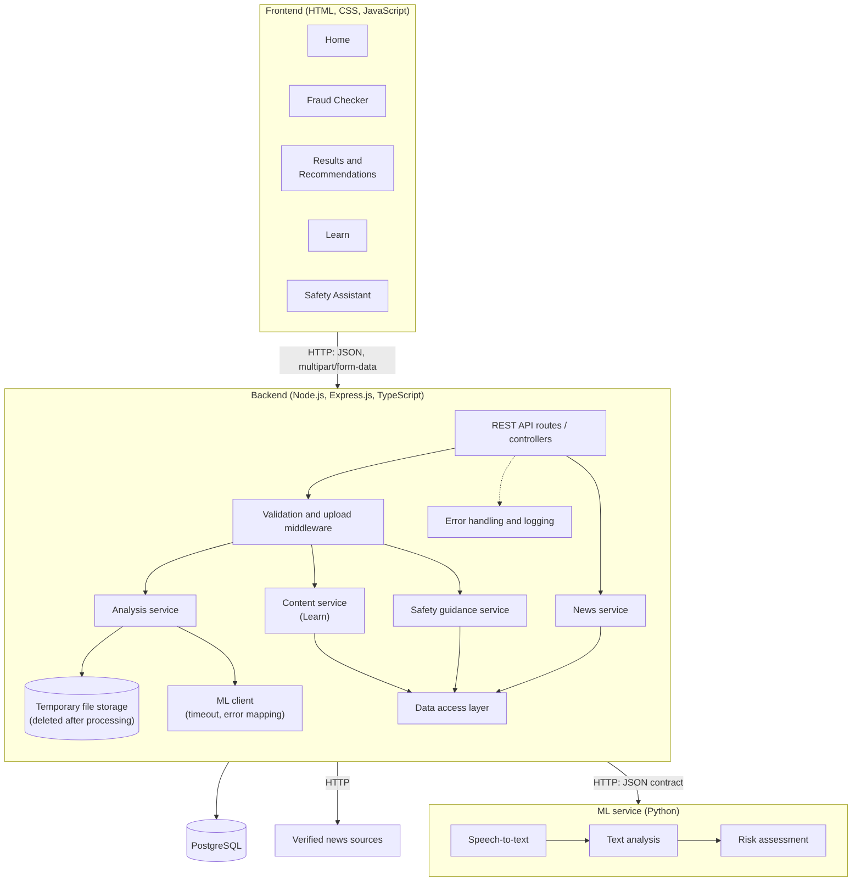

# 7. Architecture and Diagrams

## 7.1 Architectural Overview

The application follows a client-server architecture with four runtime parts: the frontend, the backend REST API, the PostgreSQL database and a separate ML service. The backend is the only component that talks to all the others, and the frontend never calls the ML service or the database directly. For a text or audio submission, the backend validates the input, passes it to the ML service, validates the response and returns the result; an uploaded recording is kept only while it is processed. Learn, Safety Assistant and news content is read from PostgreSQL. News items are initially selected from verified sources and entered into the database, and automated collection is optional (FR-23). Invalid input, unsupported files, ML timeouts, an unavailable ML service and database errors are all returned in one error format (Section 7.6). The technology choices are justified in Section 5.

## 7.2 System Context Diagram

The system is shown as one unit with its user and the external parties it depends on: verified news sources, existing speech and text models and libraries (used, not developed), and official channels, to which users are only referred. The ML service and the database are inside the system boundary.


## 7.3 Use Case Diagram




## 7.4 Component Diagram


| Component | Responsibility |
|---|---|
| REST API routes / controllers | Receive HTTP requests, call the services and return JSON responses |
| Validation and upload middleware | Validate request bodies, file type, size and duration before any processing |
| Analysis service | Coordinates text and audio assessment; stores the upload temporarily and removes it afterwards |
| ML client | Calls the ML service over HTTP with a timeout; validates the response and maps failures to API errors |
| Content service (Learn) | Returns educational materials from the database |
| Safety guidance service | Returns guidance for the selected situation |
| News service | Retrieves and returns news items |
| Data access layer | The only layer that talks to PostgreSQL |
| Error handling and logging | Converts errors to the common format and logs events without sensitive content |

## 7.5 Preliminary Data Model

The preliminary schema will be refined during implementation. It includes four core tables and one optional assessment-record table. One safety scenario has many safety steps; the other tables are independent.

| Table | Main fields | Purpose |
|---|---|---|
| fraud_technique | id, title, summary, warning_signs, prevention, language | Learn page content |
| safety_scenario | id, code, title, description, language | Situations offered by the Safety Assistant |
| safety_step | id, scenario_id (FK), step_order, text, official_channel | Ordered guidance steps for a scenario |
| news_item | id, title, source_name, url, published_at, language, fetched_at | Home page news and alerts |
| assessment_record (optional) | id, input_type, risk_level, indicators (JSON), language, created_at | Non-sensitive history; never contains the original text or audio |

## 7.6 Preliminary API Contract

The contract is a draft that the frontend and ML developers will use to align their work.

| # | Method | Endpoint | Purpose |
|---|---|---|---|
| 1 | POST | /api/analyze/text | Assess a text message (JSON) |
| 2 | POST | /api/analyze/audio | Assess an audio recording (multipart/form-data) |
| 3 | GET | /api/analyze/jobs/:id | Get the result of a long audio job |
| 4 | GET | /api/learn | List educational materials |
| 5 | GET | /api/learn/:id | Get one fraud technique |
| 6 | GET | /api/safety-assistant/scenarios | List situations |
| 7 | POST | /api/safety-assistant | Get guidance for a situation |
| 8 | GET | /api/news | List news and alerts |
| 9 | GET | /api/health | Status of backend, database and ML service |

Text request (POST /api/analyze/text)

```json
{ "text": "Your account will be blocked. Verify your details immediately.", "language": "en" }
```

Assessment response (text and audio)

```json
{
  "risk_level": "high",
  "indicators": ["urgent_request", "request_for_sensitive_information"],
  "explanation": "The message creates urgency and asks for sensitive information.",
  "recommendations": [
    "Verify the sender through an official channel",
    "Do not share passwords or verification codes"
  ],
  "transcript": null,
  "language": "en",
  "disclaimer": "This is an indicative assessment, not a guarantee."
}
```

The risk_level field is one of low, medium or high, and transcript is filled only for audio. The ML service may add a numeric score; the team decides whether to expose it.

Error response (all endpoints)

```json
{ "error": { "code": "VALIDATION_ERROR", "message": "Text must not be empty.", "details": [] } }
```

| HTTP status | Code | Situation |
|---|---|---|
| 400 | VALIDATION_ERROR | Missing or invalid field, empty text |
| 404 | NOT_FOUND | Unknown technique or job ID |
| 413 | FILE_TOO_LARGE | Audio over the size limit |
| 415 | UNSUPPORTED_MEDIA_TYPE | File is not a supported audio format |
| 422 | UNPROCESSABLE_AUDIO | Corrupted or silent recording |
| 429 | RATE_LIMITED | Too many requests |
| 502 | ML_BAD_RESPONSE | The ML service returned an invalid response |
| 503 | ML_UNAVAILABLE | The ML service cannot be reached |
| 504 | ML_TIMEOUT | The ML service did not answer in time |
| 500 | INTERNAL_ERROR | Unexpected server error |

ML service contract (backend to ML service)

| Method | Endpoint | Request | Response |
|---|---|---|---|
| POST | /ml/analyze/text | { "text": "...", "language": "ru" } | { "risk_level", "indicators", "explanation", "language" } |
| POST | /ml/analyze/audio | multipart/form-data with the audio file and a language field | { "transcript", "risk_level", "indicators", "explanation", "language" } |

The backend checks every ML response against this structure and rejects malformed ones (ML_BAD_RESPONSE). Until the ML service is ready, the backend is developed and tested against a mock service that returns responses in this format.
