# 8. UX / Prototype

## User Interface and Technology Stack

The Fraud Risk Assessment Web Application will consist of five main pages: Home, Fraud Checker, Results and Recommendations, Learn, and Safety Assistant. The application will allow users to submit suspicious text messages or upload audio recordings, review potential fraud indicators, and receive practical safety recommendations.

The user interface will be developed using HTML, CSS, and JavaScript. HTML will define the structure of the web pages, CSS will provide styling and responsive layouts, and JavaScript will implement interactive elements, form validation, file submission, and dynamic presentation of analysis results.

## Interactive Figma Prototype

An interactive prototype of the Alay-Aq web application was developed using Figma Make. It demonstrates the user interface, navigation, and key interactions across five pages: Home, Fraud Checker, Results and Recommendations, Learn, and Safety Assistant.

Prototype link: [Open Prototype in Figma](https://www.figma.com/make/mAZvGzwnixFOTvGZ1eUSVO/Interactive-UX-Prototype-Build?t=zAJtllnfuonUZYQ1-20&fullscreen=1&preview-route=%2F%23%2Fassistant)

The prototype illustrates text and audio submission, assessment results, educational content, and situation-specific safety recommendations. Analysis results are simulated for demonstration purposes; the backend and ML integration have not yet been implemented.

## User Scenario Flows

User interaction scenarios were developed to illustrate how users navigate the proposed web application and complete its main tasks. The diagrams represent navigation between the five application pages, fraud news and educational content, text and audio assessment workflows, assessment results, and situation-specific safety guidance.

The text and audio workflows include input validation, processing, successful assessment, and error-handling paths. The Safety Assistant workflow illustrates how users select a relevant situation and receive step-by-step recommendations.

The diagrams describe the intended user experience and will serve as a reference for the development and evaluation of the interactive prototype.

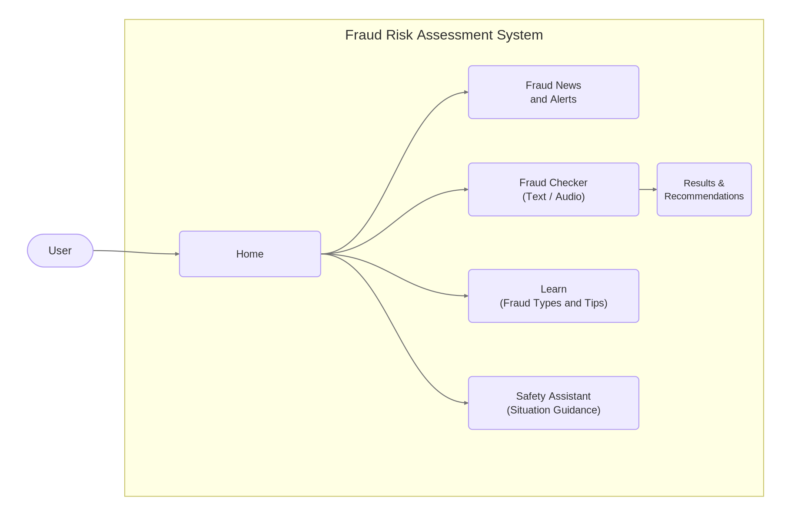

Figure 1. Main User Navigation Flow

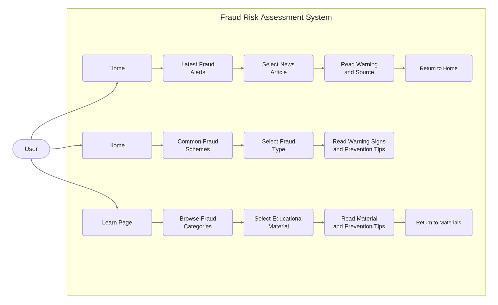

Figure 2. Fraud News and Educational Content Flow

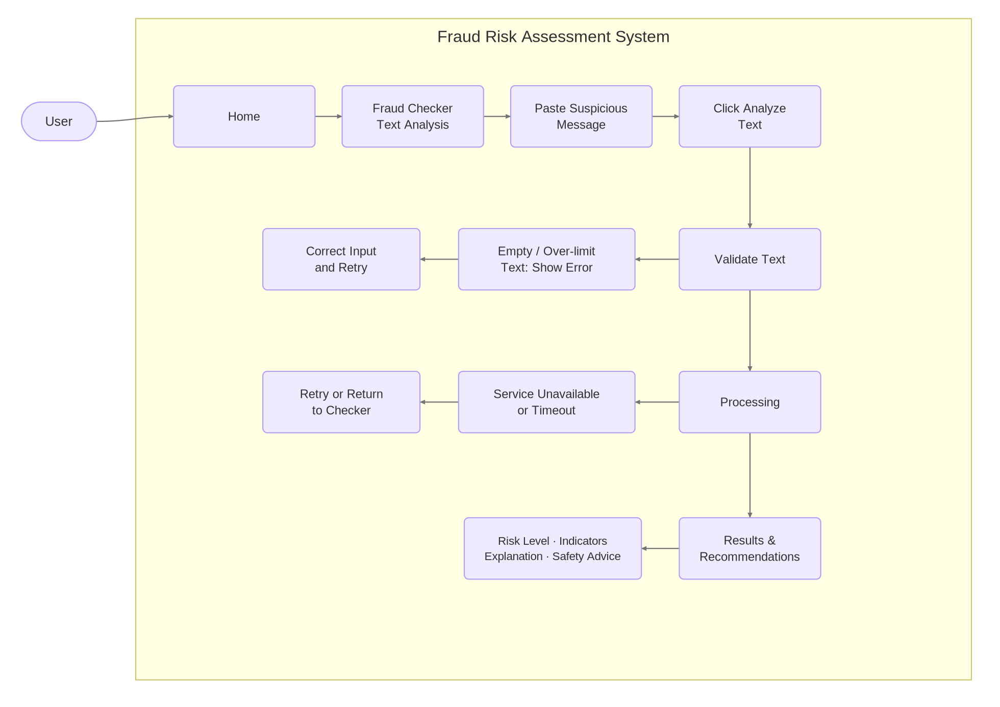

Figure 3. Text Fraud Assessment Flow

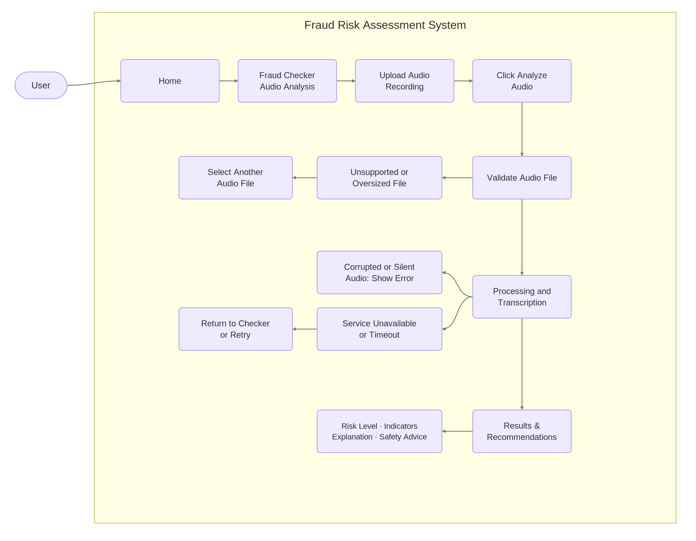

Figure 4. Audio Fraud Assessment Flow

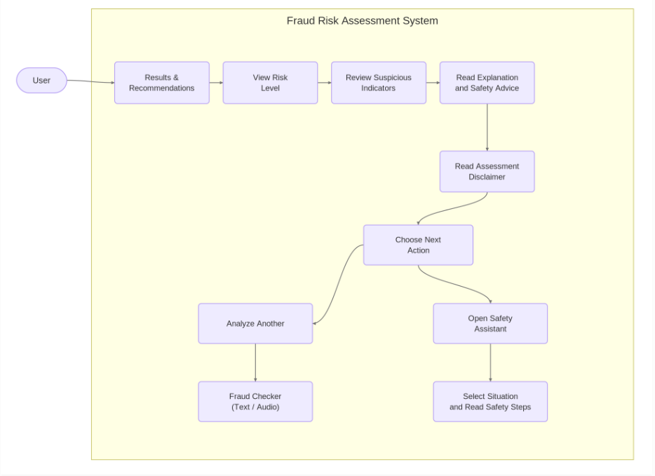

Figure 5. Assessment Results and Follow-Up Actions

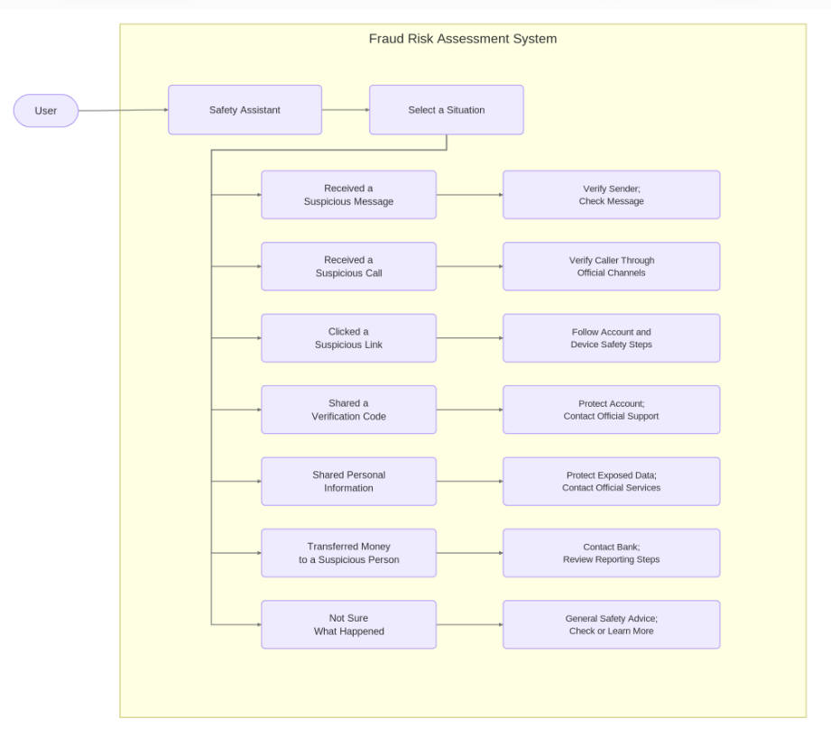

Figure 6. Safety Assistant Interaction Flow

## Mockups of Key User Scenarios

The following wireframes illustrate the proposed interface and the main interactions between users and the application.

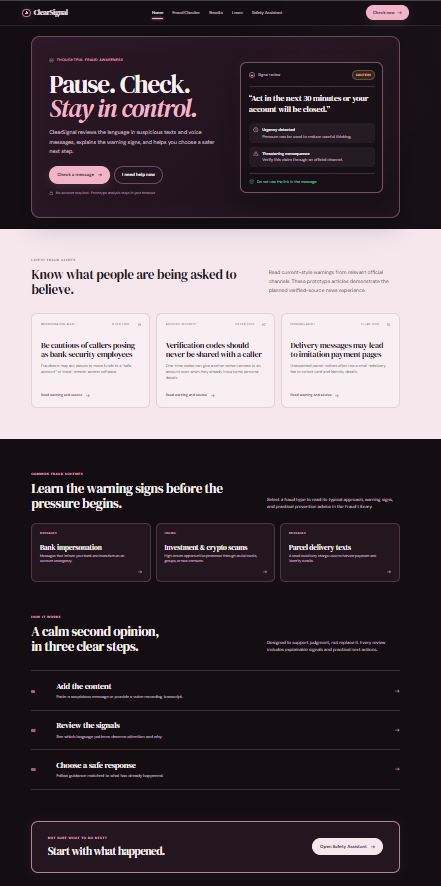

Figure 7. Home Page Mockup

The Home page introduces the application's purpose and provides navigation to its main features. Users can start an assessment or access educational content about fraud prevention.

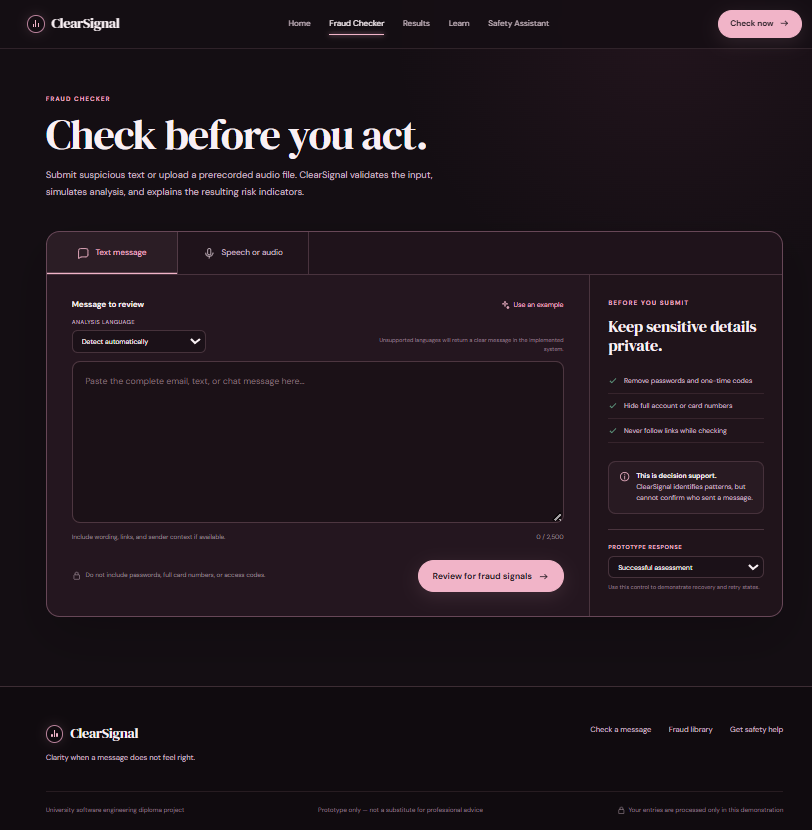

Figure 8. Fraud Checker Page Mockup

The Fraud Checker page provides two input methods: text submission and audio file upload. Users can enter a suspicious message or select a prerecorded audio file and initiate an assessment. The interface includes input validation, loading feedback, and error messages for invalid or unsupported submissions. The interactive prototype demonstrates these interactions using illustrative data.

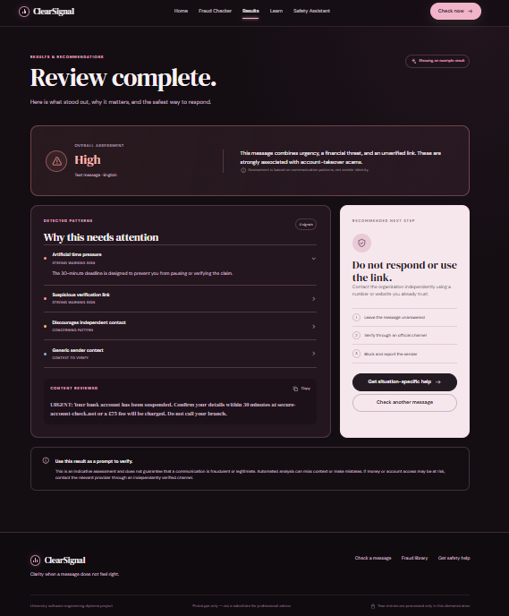

Figure 9. Results and Recommendations Page Mockup

The Results and Recommendations page demonstrates how users will review an estimated fraud risk level, suspicious indicators, explanations, and recommended safety actions. The prototype displays illustrative assessment results to demonstrate the intended user experience.

The displayed risk level and indicators are illustrative examples. Actual outputs will depend on the selected ML method and evaluation results.

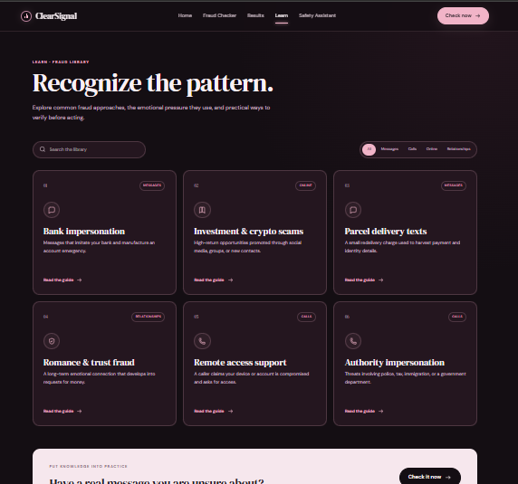

Figure 10. Learn Page Mockup

The Learn page will provide educational materials about common fraud techniques, warning signs, and prevention methods. The content will help users recognize potentially fraudulent communications independently of the automated analysis.

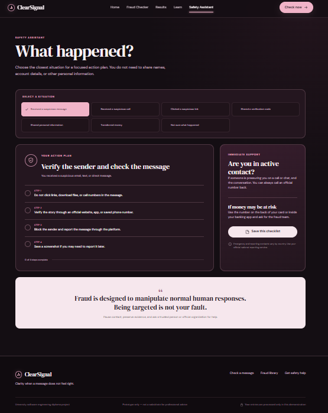

Figure 11. Safety Assistant Page Mockup

The Safety Assistant will provide guidance for common suspicious situations. The interface will present relevant recommendations and direct users toward appropriate official channels when necessary. Its implementation may use predefined guidance, backend logic, or an additional AI component, depending on the final design.
